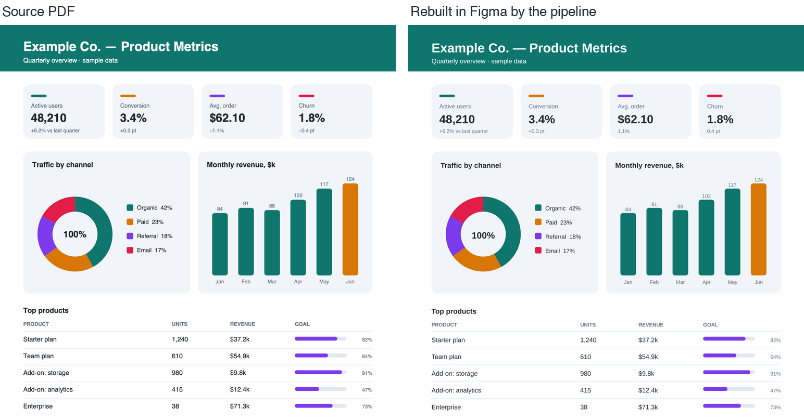
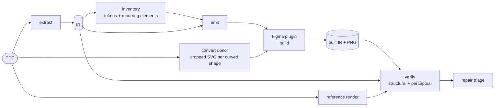
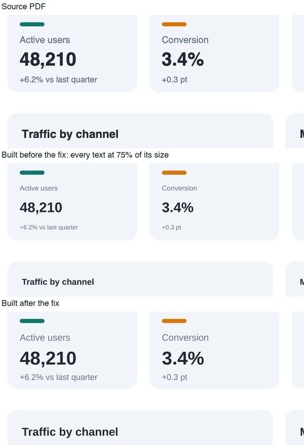

# pdf-to-figma

[](https://github.com/serge-ai-infra/pdf-to-figma/actions/workflows/ci.yml)

Rebuild a PDF as a componentized Figma file — and measure how close the rebuild
is, per region, instead of claiming it.



The demo document is generated by [`scripts/make-demo-pdf.py`](scripts/make-demo-pdf.py)
(all figures invented) and committed as [`docs/demo/demo.pdf`](docs/demo/demo.pdf).
Against it, `verify` reports **97 of 102 source nodes structurally matched** and
**96.8% of pixels** matching at 200 dpi; every non-match is accounted for in
[Demo run](#demo-run) below.

## The problem

Figma has no PDF import. Every workaround — the macOS clipboard, an SVG
conversion, `figma.createNodeFromSvg` in a plugin — lands a flat pile of unnamed
vector nodes: no hierarchy, no components, no editable text, and fonts silently
substituted (Figma ignores `@font-face` in SVG). Fine as a picture, useless as a
design file.

## What this does instead

- **Extract** geometry, style and text from the PDF into a deliberately dumb JSON
  intermediate representation — no chart types, no business terms.
- **Inventory** the document: color palette, type scale, spacing grid and
  recurring elements, each with how much unifying it cost — the raw material for
  a design system.
- **Build** in Figma through a plugin: recurring elements become components and
  instances, text stays live text. Curved shapes the IR can't describe are
  inherited from the PDF as cropped SVG *geometry donors* instead of being
  redrawn badly.
- **Verify** the build: export what Figma actually built, diff it against the
  source structurally (per node) and perceptually (per region, against a
  reference render), then triage mismatches into systemic vs. one-off.

## Results on real documents

Run end to end on a small set of real dashboard-style reports
(third-party documents, so not included here; every number is reproducible on
any PDF with the `verify` commands below). These runs predate the font-size fix
described under [What measurement caught](#what-measurement-caught): text in
those builds was 25% too small, which the pixel numbers below did not reveal.

| Measure | Result |
|---|---|
| Structural match | **98.3%** of several thousand source nodes rebuilt with matching geometry, fill and text; every non-dashboard page within one mismatch of perfect |
| Pixel match, per page | **91.4–95.5%** at an 8/255 threshold |
| Ceiling for that number | **~96%** — what an *untouched* vector import of a similar page scores, because two rasterizers disagree at every edge ([how it was measured](figma-plugin/README.md#observed-ceiling)) |

The remaining structural gap is root-caused, not noise: pairs of shapes with an
identical bounding box (a gauge's track and its value) that a bbox-based crop
cannot tell apart, and ZapfDingbats glyphs Figma has no font for.

## How it works



Python owns everything up to the IR and back; TypeScript owns the Figma side
(`emitter/` builds the payload, `figma-plugin/` turns it into nodes). Every stage
reads and writes JSON files, so each one runs and is tested on its own, without
a PDF or a Figma account.

## What measurement caught

The point of verifying is that it finds things nobody was looking for:

- **Cards built as circles.** Per-region verify flagged four KPI cards at ~66%
  match. Cause: the extractor called any near-square curved path an ellipse, and
  a rounded rectangle qualifies. Fix: every vertex must hug the inscribed
  ellipse ([`_hugs_ellipse`](src/pdf2figma/extract/pdf.py)) — the cards went to
  ~90%.
- **A design assumption that didn't survive a probe.** The plan was to crop
  regions with `pdftocairo`'s `-x/-y/-W/-H` flags. Tested on a real file first:
  for vector output they are silently ignored. The donor design was changed
  before any code was written
  ([spec](docs/specs/s3.5-geometry-donor/spec.md)).
- **A bug in the measuring tool, not the build.** One page showed 107
  mismatches; the build was fine — the exporter read the wrong child's fill on
  multi-path donors ([`visualNode`](figma-plugin/src/code.ts)). 107 → 6, and the
  6 are the identical-bbox limit above.
- **A bug the metrics couldn't see — and a wrong conclusion about it.** Live
  text sat at roughly half the pixel match of shapes on every real report, and
  was written off as a ceiling: two font rasterizers disagreeing at small sizes.
  Building the demo in a fresh environment showed what the numbers hid: every
  text was built at **75% of its size**. Font size and stroke width were passed
  to Figma in points while all geometry was in pixels, and the exporter had the
  mirror-image omission, so structural verify saw matching numbers. Per-region
  pixel match even scored the shrunken text *slightly higher* (fewer glyph edges
  to disagree on). Fixed on both sides with a regression test, and `verify
  structural` now compares font size and stroke width. A geometric check catches
  what pixel matching can't — text ink width against the reference went from
  0.75 to 1.00 — but it isn't part of `verify` yet.
  
- **Text that wrapped once it was the right size.** With correct sizes, three
  one-line headings wrapped: plain text nodes got a fixed width equal to the
  PDF's bbox, and a substitute font a hair wider forces a line break. A PDF text
  run is one line, so the build now sizes text to its content first.

## Status

**Works today:** extraction, inventory, payload emission, building in Figma
(components, instances, live text), geometry donors, structural and perceptual
verification, repair triage, and a regression suite for bugs that actually
shipped.

**Not built yet:** auto layout, Figma variables, component variants, font
extraction, and an automated repair loop (triage is automated; fixes are
applied by hand). Building runs inside Figma, since Figma has no headless
mode: a human clicks Build in Figma Desktop, or an agent drives the same plugin
code through Figma's MCP server, as for the demo below.

## Demo run

How the images above were produced, and what didn't match:

- **Pipeline.** `./scripts/run-pipeline.sh docs/demo/demo.pdf`: 102 source
  nodes, 11 recurring candidates, a payload of 8 components with 61 instances,
  4 one-off nodes, and 35 geometry donors (rounded cards, donut segments, bars,
  progress bars).
- **Build.** The plugin's own build, donor-import and export code
  (`figma-plugin/src/code.ts`) was run through the Figma Plugin API by an agent
  via Figma's MCP server, not clicked through in Figma Desktop. That runtime
  needed two adaptations: `setSharedPluginData` instead of `setPluginData`, and
  Arimo, which is metric-compatible with Helvetica, because Figma's cloud fonts
  don't include Helvetica.
- **Reference.** Rendered at 200 dpi with macOS CoreGraphics. Poppler on the
  same machine draws the PDF's non-embedded Helvetica-Bold at regular weight
  (fontconfig itself resolves `Helvetica:bold` correctly, so the weight is lost
  inside poppler's font lookup) — a reference that is wrong before any
  comparison starts. Against the poppler render the page scores about 0.1
  points higher than the number below.
- **Structural: 97 matched, 3 mismatched, 2 missing.** One donut segment's
  cropped donor also contains its neighbour, and the exporter reads the
  neighbour's fill — the multi-path donor limit seen on the real reports. Two
  headings come out 0.7–0.84pt wider than the source: Arimo matches Helvetica's
  metrics, but not to the hundredth of a point. The two missing nodes are the
  minus signs in "−1.1%" and "−0.4 pt", which the PDF draws from the Symbol
  font, which Figma doesn't have.
- **Perceptual, 200 dpi, 8/255 threshold: 96.8% of the page.** Per region,
  curved shapes rebuilt from donors average 96.9%; text averages 53.5%, a number
  that says little about text, as the font-size story above shows.

## How it was built

Each stage has a spec and an acceptance checklist, written before the code, in
[`docs/specs/`](docs/specs/): S1 extract, S2 tokens and inventory, S3.5
geometry donor, S4 emit and build, S5 verify, S6 repair triage, plus the
regression harness. A box is ticked against a real run, not when the code
exists; when real data overturns a decision, it is struck through with the
reason rather than quietly rewritten — see automatic region selection in the
[geometry-donor spec](docs/specs/s3.5-geometry-donor/spec.md).

Python is `mypy --strict` and `ruff` clean with 157 tests; the emitter has its
own test suite; `scripts/verify-regression.sh` runs all of it. CI runs that
script, a smoke run of the demo PDF through every stage that doesn't need Figma
(`scripts/smoke-demo.sh`), and a gitleaks scan of the full history.

---

## Usage

### Quick start: one PDF, one command

```
./scripts/run-pipeline.sh report.pdf
```

Runs extract → inventory → auto-profile (componentizes every recurring
element it found) → emit, and stops with exact instructions for the one step
nothing can automate: Figma has no headless mode, so building the file
itself needs a human clicking **Build** in Figma Desktop's plugin panel.
That's the only manual step if you just want the file.

Want to know whether the build actually matches the source? After building,
export `built.json` from the plugin's fourth panel, then:

```
./scripts/validate-build.py out/pipeline/doc.ir.json built.json \
  --payload out/pipeline/doc.payload.json --pretty
```

One JSON report — structural diff, pattern-triaged, with a top-line
`"verdict": "ok" | "needs-review"`. See "Verifying a build" and "Repair
triage" below for the full picture (per-region detail, the optional
perceptual/pixel half, round tracking) — this wrapper is the fast path
through the same tools for a single document.

### Design principles

- **No hardcoded domain knowledge.** The engine knows `TextRun`, `Shape`,
  `Cluster` — never a chart type or a business term. Everything
  document-specific lives in a profile, which is data you supply.
- **No hardcoded values.** Palette, type scale, spacing and radii are derived
  from the document. There is not a single hex literal in the engine.
- **Stages exchange files.** Each stage reads JSON and writes JSON, so any stage
  runs standalone, and its output is inspectable and testable without a PDF or a
  Figma account.
- **Pluggable input.** Extraction sits behind an `Extractor` protocol; a layout
  specification from an upstream generator could feed the same IR.
- **Offline.** No network calls anywhere; the plugin's manifest allows no
  domains.
- **Fidelity is measured, never assumed.** Verification is a command, not a
  claim; unification tolerances are explicit parameters and their cost in
  fidelity is reported.

### Requirements

- Node 20+ (Figma plugin, emitter)
- Python 3.12+ (extraction, rendering, comparison)
- [poppler](https://poppler.freedesktop.org/) (`pdfinfo`, `pdffonts`,
  `pdftocairo`, `pdftoppm`) — `brew install poppler`
- Figma **Desktop** for the build step. Fonts extracted from a PDF must be
  installed locally; Figma cannot load fonts from an API or a plugin.

### Install

```
python3.12 -m venv .venv
.venv/bin/pip install -e ".[compare,dev]"
```

### Extracting

```
.venv/bin/pdf2figma extract report.pdf -o report.ir.json --pretty
```

Writes geometry, style and text as JSON — text runs with font, size and exact
fill color; shapes as rect, ellipse, line or path; images. No interpretation: a
donut is an ellipse and some curves, and naming it is a later stage's job.

Coordinates are top-left with y downward, in PDF points. The output records no
path and no filename, so an extract can be shared without disclosing its source.

`--pages 2-4,7` limits the work; `--no-text-color` is faster and blinder.

### Building an inventory

Once you have IR for one or more documents built from the same template:

```
.venv/bin/pdf2figma inventory report-*.ir.json -o report.inventory.json --pretty
```

Reports a color palette, a type scale, a spacing grid, and recurring shape and
text atoms — each with how often it occurs, how many of the input documents it
appears in, and how much unifying it cost. A single file works; more documents
of the same template make the report stronger, since only a corpus can say
which differences are the template and which are the data.

Every clustering tolerance is a flag (`--color-tolerance`, `--size-tolerance`,
`--spacing-tolerance`, `--min-occurrences`) and is echoed back in the report —
never a hidden default you have to remember.

### Emitting a payload

Once you have IR for the document you want to build and an Inventory from its
corpus:

```
cd emitter && npm install && npm run build
node dist/src/cli.js ../report.ir.json ../report.inventory.json \
  --profile ../report.profile.json -o ../report.payload.json --pretty
```

Matches every node against the Inventory's tokens and candidates, and turns
the result — plus an optional profile deciding which candidates become
components, with what name, with live text or not — into a payload the Figma
plugin can build from. `--profile` is optional; without one, nothing gets
componentized and every node lands as a plain shape or text node.

`--page N` selects a page (1-based, default 1) — one payload, one page, same
granularity as vector import. The pt→px (×4/3)
conversion happens here, once; nothing upstream or downstream touches it.

### Building in Figma

```
cd figma-plugin && npm install && npm run build
```

Then in Figma Desktop, **Plugins → Development → Import plugin from
manifest…**, pick `figma-plugin/manifest.json`. The plugin's third panel picks
a `*.payload.json` and builds it: components + instances for every candidate
the profile asked to componentize, plain nodes for everything else. Re-running
against the same file updates existing component masters instead of
duplicating them — see [figma-plugin/README.md](figma-plugin/README.md) for
what that does and doesn't cover this pass (no auto layout, no variables, no
variants yet).

### Geometry donors

`path`-kind shapes (donuts, gauges, custom curves) carry only a bbox — the
extractor never keeps a raw contour — so `emit` marks every one
`unsupported` and stops there. This is the tool that gives them geometry
back, inherited from the PDF's own vector conversion rather than generated:

```
.venv/bin/pdf2figma convert donor report.pdf report.ir.json -o donors.json --pretty
```

Converts the page to SVG once, then crops it down to each region: keeps
only the geometry that falls inside that region's bbox, drops every text
glyph unconditionally (the build step already creates live text for the same region
from the IR — outlining it too would draw a dead copy underneath), and
rewrites the result to a small standalone SVG sized to just that bbox.

No `--ids` needed for the normal case — every `path`-kind node on the page
gets a donor. On a real report that's routinely over a hundred (rounded
bars, donuts and curved section headers are all curves to a PDF, all
`path` to the extractor's classifier — on one real page `path` outnumbered `rect`
ten to one), so hand-picking which ones matter doesn't scale.
`--ids p0.c12,p0.c15` still works for a scoped/ad-hoc run against one
region.

`pdftocairo -svg`'s own `-x/-y/-W/-H` crop flags do **not** work for this —
verified directly: they silently leave vector output at full page size and
only affect raster formats. `convert donor` crops by filtering the SVG's
own elements instead. See
[docs/specs/s3.5-geometry-donor/spec.md](docs/specs/s3.5-geometry-donor/spec.md)
for the mechanism.

In Figma Desktop, the plugin's fifth panel imports the result: one
`createNodeFromSvg` per donor, positioned and tagged the same way every
other built node is — so `verify structural` picks it up with zero changes
to the payload or verify models. **Run order matters**: import donors
*after* Build (panel 3 clears the frame on every run) and *before* Export
built IR (panel 4) if the donor should show up in the structural diff.

### Verifying a build

Once you've built something (previous section), export what actually got
built from the plugin's fourth panel — a `*.built.json`, the counterpart to
the payload in the other direction — then compare it back against the source:

```
.venv/bin/pdf2figma verify structural report.ir.json build.built.json \
  --payload report.payload.json -o report.structural.json --pretty
```

Reports, per source node: `matched`, `mismatched` (with the actual
difference — "fill '#336699', expected '#3366cc'"), `missing` (nothing built
for it — could be an intentional build-time skip or a real bug, this tool doesn't
judge which), or `extra` (built but untraceable to any source node).
`--payload` is optional and attaches the emitter's own recorded reason to a
`missing` region when there is one.

For the visual half, render a reference PNG and export the same page from
Figma at the same DPI (see "Measuring the ceiling" below for exactly how),
then:

```
.venv/bin/pdf2figma verify perceptual reference.png exported.png report.ir.json \
  --dpi 200 -o report.perceptual.json --pretty
```

Crops both images to every source node's own bbox and compares per region —
never the whole page, since a broken region can hide inside a page-level
average. A whole-image number is still reported too, for continuity with the
ceiling measurement, but the per-region results are the point.

Neither command fixes anything — see
[docs/specs/s5-verify/spec.md](docs/specs/s5-verify/spec.md) for what's
deliberately out of scope this pass (the repair loop, chiefly).

### Repair triage

Two verification reports in, a triage in — still nothing gets fixed
automatically. `structural` groups a report's mismatches by what actually
diverges and says whether that pattern is worth fixing in the pipeline itself:

```
.venv/bin/pdf2figma repair structural report.structural.json \
  -o triage.json --pretty
```

A pattern recurring in `--systemic-threshold` (default 2) or more regions is
`systemic`; below that, `one-off`. Feed it several reports at once — from
different documents built the same way — to triage across a corpus, not just
one page.

For perceptual mismatches, `perceptual-round` tracks a region's score across
repeated runs and marks it `needs-human` once it's gone `--needs-human-after`
(default 2) rounds without improving — the bookkeeping a human-applied
fix-and-remeasure cycle needs:

```
.venv/bin/pdf2figma repair perceptual-round report.perceptual.json \
  --previous previous-round.json --threshold 95 -o round.json --pretty
```

Before that cycle's first fix attempt, `crops` saves the reference, candidate
and diff-map images a hypothesis needs — the same three inputs
`docs/architecture.md` describes for a vision-assisted repair step:

```
.venv/bin/pdf2figma repair crops reference.png exported.png report.ir.json \
  --ids p0.t5,p0.r12 --dpi 200 -o work/repair-crops/
```

Writing the hypothesis itself — what's actually wrong, looking at those three
images — isn't something this command does; ask an agent (or look yourself)
and feed the result back in via `perceptual-round --hypotheses`. See
[docs/specs/s6-repair-triage/spec.md](docs/specs/s6-repair-triage/spec.md) for
why that step stays manual.

### Regression checks

Every deterministic-code check this repo can run without opening Figma, in
one command:

```
./scripts/verify-regression.sh
```

Python tests + `ruff` + `mypy --strict`, the emitter's own test suite +
`tsc`, and the plugin's `tsc --noEmit` — including a set of synthetic
fixtures shaped after three real bugs this project already shipped and
fixed (font-suffix stripping, component-instance recolor, and the
`pdftocairo` vector-crop flags that turn out not to work at all — see
[docs/specs/regression-harness/spec.md](docs/specs/regression-harness/spec.md)).
Building, importing donors and exporting built IR in Figma Desktop stay
manual either way — nothing here can automate the one step that genuinely
needs a live plugin session.

### Probing a document

Before anything else, find out what a given PDF is actually made of:

```
./scripts/probe-pdf.sh <input.pdf> work/probe
```

Writes a report plus per-page SVG and PNG renders under the output directory.
Nothing leaves your machine.

### Measuring the ceiling

Two different rendering engines are involved, so a perfect score is not
reachable. Before judging any rebuild, find out what *is*: import the vector
conversion into Figma untouched, export it back, and compare against the
reference render.

```
./scripts/probe-pdf.sh report.pdf work/probe 200   # reference + vector
# import work/probe/svg/page-1.svg via the plugin, export at 200 dpi
python scripts/compare-images.py work/probe/png/page-1.png exported.png -o diff.png
```

That number is the ceiling. Later stages are scored against it, not against 100%.
See [figma-plugin/README.md](figma-plugin/README.md).

## Docs

- [docs/architecture.md](docs/architecture.md) — pipeline, IR contract,
  verification, where agents belong, anti-coupling rules
- [docs/roadmap.md](docs/roadmap.md) — stages, each ending in something runnable
- [docs/specs/](docs/specs/) — per-stage spec and acceptance checklist

## License

MIT
